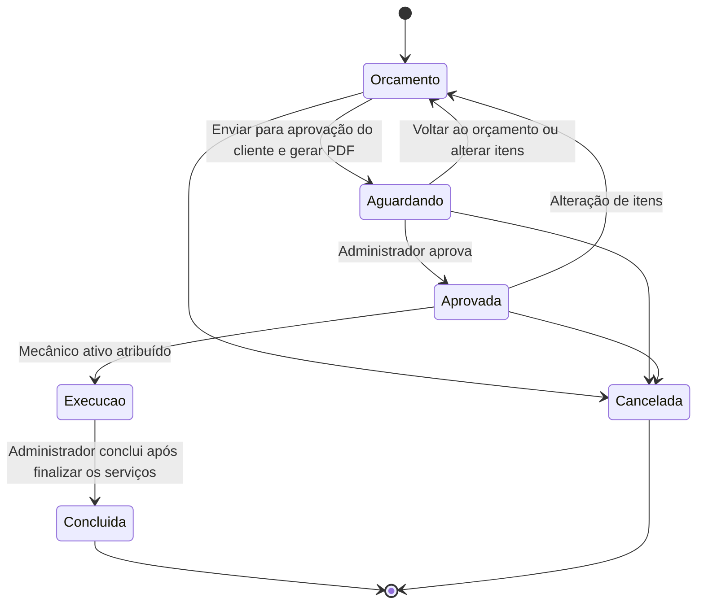
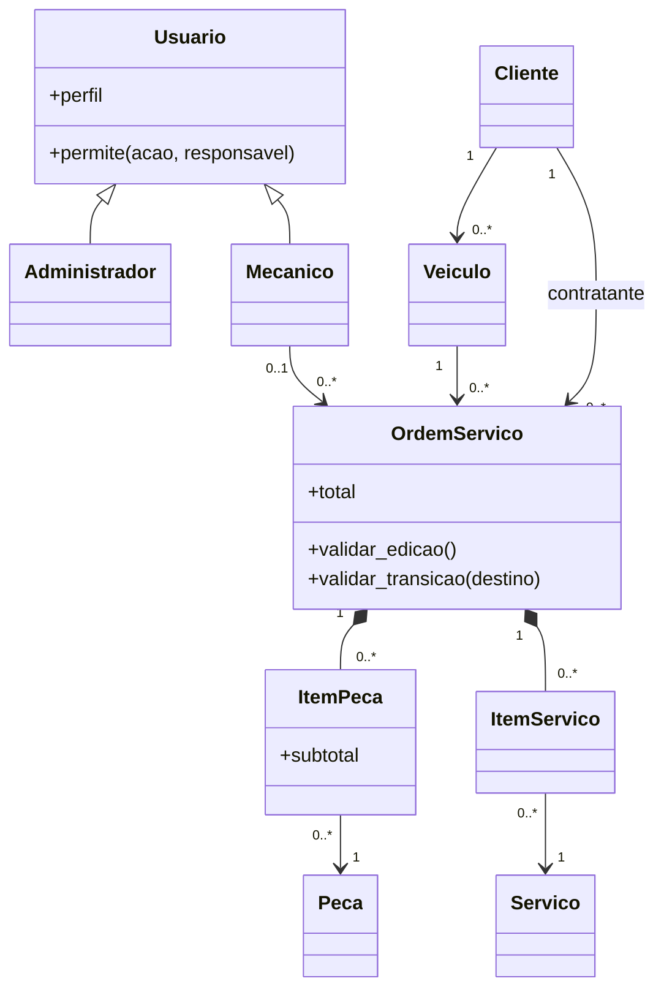

# Oficina · Gestão de serviços

Aplicação local em **Python + SQLite + Streamlit**, implementada a partir do plano aprovado para a disciplina de Programação Orientada a Objetos.

## Iniciar no ambiente entregue

Abra um terminal nesta pasta e execute:

```powershell
.\.venv\Scripts\python.exe -m streamlit run app.py
```

Ou execute `iniciar.cmd` no Windows. Acesse **http://127.0.0.1:8501**.

No primeiro acesso, crie seu administrador, com uma senha de no mínimo 8 caracteres, uma letra maiúscula, uma minúscula e pelo menos um caractere especial. **Não existe senha padrão.** Depois, entre com as credenciais criadas.

O banco é criado automaticamente em `data/oficina.sqlite3`. A aplicação inicia vazia; os dados fictícios usados nos testes não são inseridos no banco da oficina.

## Instalar em outro computador

Recomendado: Python 3.12 e ambiente virtual. Os comandos abaixo devem ser executados na raiz do projeto:

```powershell
py -3.12 -m venv .venv
.\.venv\Scripts\python.exe -m pip install -r requirements-lock.txt
.\.venv\Scripts\python.exe -m streamlit run app.py
```

Em Linux/macOS, substitua `.venv\Scripts\python.exe` por `.venv/bin/python` e crie o ambiente com `python3 -m venv .venv`.

`requirements-lock.txt` registra as versões usadas na validação. `pyproject.toml` declara o projeto e suas dependências principais. O código é executado diretamente a partir desta pasta; mantenha `src/`, `migrations/`, `.streamlit/` e `app.py` juntos.

## Primeiro atendimento

1. Em **Clientes**, cadastre uma pessoa física com CPF válido.
2. Em **Veículos**, cadastre o veículo e selecione seu proprietário.
3. Em **Usuários**, cadastre um funcionário com o perfil **Mecânico**.
4. Em **Serviços**, cadastre a mão de obra e o preço.
5. Em **Peças e estoque**, cadastre as peças e registre uma entrada de estoque; a justificativa é opcional.
6. Em **Ordens de serviço**, abra uma OS, informe o problema e selecione o veículo e o mecânico.
7. A OS começa em orçamento: adicione peças e serviços e selecione **Enviar para aprovação do cliente**. Baixe o PDF gerado para compartilhar com o cliente.
8. Como administrador, aprove o orçamento.
9. Inicie a execução; inicie e finalize cada serviço.
10. Conclua a OS, fature, registre o pagamento integral e registre a entrega do veículo.
11. Consulte o histórico pelo nome do cliente, CPF ou placa.

Os valores monetários aceitam `1234,56` ou `1234.56`, sem separador de milhar.

## Perfis e permissões

| Operação | Administrador | Mecânico |
|---|---|---|
| Cadastros e estoque | Sim | Não |
| Abrir, editar e cancelar OS | Sim | Não |
| Consultar OS | Todas | Apenas as atribuídas |
| Consultar histórico | Todos os veículos | Veículos de OS atribuídas |
| Adicionar itens | Sim, conforme o estado | Apenas suas OS em orçamento |
| Remover itens | Sim, conforme o estado | Solicita ao administrador |
| Aprovar orçamento | Sim | Não |
| Iniciar execução e atualizar serviços | Sim | Apenas suas OS |
| Concluir OS | Sim | Não |
| Faturar, registrar pagamento e entrega | Sim | Não |

As permissões são verificadas nos serviços de aplicação a cada operação. Inativar um usuário revoga seu acesso na próxima operação ou atualização da tela. O último administrador ativo não pode ser inativado, excluído ou convertido em mecânico.

## Regras implementadas

- Cliente e veículo precisam estar ativos para novos atendimentos.
- O veículo deve pertencer ao cliente selecionado.
- CPF, placa, login, preços e quantidades são validados.
- CPF, placa e login não podem se repetir.
- OS sem mecânico pode existir durante o orçamento, mas não iniciar execução.
- Aprovação e conclusão exigem pelo menos um serviço.
- Todos os serviços precisam estar finalizados para concluir a OS.
- OS concluída ou cancelada não aceita alterações de itens.
- Alterar itens de um orçamento pendente ou aprovado retorna a OS para **Em orçamento**.
- Alterações durante a execução exigem administrador e justificativa.
- Serviços iniciados e peças consumidas não podem ser removidos.
- Cancelamento é permitido apenas antes da execução e exige justificativa.
- Faturamento, pagamento integral e entrega são únicos por OS.
- Pagamentos de valor zero usam a forma **Sem cobrança**.
- Cadastros com vínculos não são excluídos fisicamente. Clientes com histórico são inativados.
- Cadastros de cliente/veículo com OS em andamento não podem ser inativados; mecânicos com OS em andamento precisam ter seus atendimentos reatribuídos antes de inativação ou mudança de perfil.
- A transferência de veículo só é permitida sem OS em andamento. A OS preserva o cliente original do atendimento.

### Estados



Faturamento, pagamento e entrega são eventos posteriores à conclusão, com registros próprios; não substituem o estado técnico da OS.

### Estoque

- Ao adicionar peça antes da execução, a quantidade é **reservada**.
- Disponível = saldo físico − reservas de OS não canceladas.
- Ao iniciar a execução, a reserva é convertida em consumo, reduzindo o saldo físico.
- Peças adicionadas durante a execução são consumidas imediatamente.
- Remover uma peça reservada ou cancelar a OS libera a reserva.
- Movimentos e alterações da OS são salvos na mesma transação.
- Transações de escrita usam `BEGIN IMMEDIATE`: duas sessões não conseguem reservar o mesmo saldo simultaneamente.

## Arquitetura

```text
Streamlit → Serviços de aplicação → Domínio + Repositórios → SQLite
```

```text
app.py                           Entrada da aplicação
src/oficina/config.py            Configuração e caminhos
src/oficina/domain/              Entidades, validações, enums e exceções
src/oficina/application/         Autenticação, cadastros, estoque e OS
src/oficina/infrastructure/      SQLite, repositórios e hash de senhas
src/oficina/ui/                  Telas e componentes Streamlit
migrations/                     Migrações SQL versionadas
scripts/                        Inicialização, administrador e backup
tests/unit/                     Validações e comportamento de domínio
tests/integration/              Persistência, transações e regras completas
tests/ui/                       Interações com formulários e navegação
data/                           Banco local, fora do versionamento
logs/                           Logs técnicos, fora do versionamento
```

Entidades pequenas estão agrupadas em `domain/entities.py`; as telas estão divididas por funcionalidade. Essa organização mantém as camadas do plano sem criar arquivos vazios ou abstrações sem uso.

### Orientação a objetos



`Usuario` é abstrato. `Administrador` e `Mecanico` implementam permissões por polimorfismo. Os itens são compostos pela OS e preservam preço e descrição do momento da inclusão. As entidades não importam SQLite nem Streamlit.

## Banco e configuração

- `migrations/001_initial.sql` contém tabelas, índices e restrições.
- `schema_migrations` registra as migrações aplicadas.
- A inicialização não apaga dados e pode ser executada novamente.
- Valores monetários são armazenados em centavos inteiros.
- Datas são persistidas em UTC e exibidas no fuso `America/Sao_Paulo`.
- Senhas usam PBKDF2-HMAC-SHA256, salt aleatório individual e comparação em tempo constante.
- SQL é parametrizado; nomes de tabela dinâmicos são limitados a uma lista interna.

Para definir outro banco, configure uma variável de ambiente antes de iniciar:

```powershell
$env:OFICINA_DB = "C:\dados\oficina.sqlite3"
.\.venv\Scripts\python.exe -m streamlit run app.py
```

O arquivo `.env.example` é apenas um exemplo; a aplicação não carrega arquivos `.env` automaticamente.

Comandos opcionais:

```powershell
.\.venv\Scripts\python.exe scripts/init_db.py
.\.venv\Scripts\python.exe scripts/create_admin.py
```

`create_admin.py` cria somente o primeiro administrador. Administradores adicionais são cadastrados pela tela de usuários.

## Testes

```powershell
.\.venv\Scripts\python.exe -m pytest -q
.\.venv\Scripts\python.exe -m ruff check .
.\.venv\Scripts\python.exe -m ruff format --check .
```

Os testes usam bancos temporários isolados. O fluxo de interface é exercitado com [AppTest, ferramenta oficial do Streamlit](https://docs.streamlit.io/develop/api-reference/app-testing/st.testing.v1.apptest).

### Rastreabilidade

| Requisito | Implementação | Validação |
|---|---|---|
| RF01–RF03: clientes, veículos e funcionários | `CadastroService`, telas de cadastro | Integração e testes de formulários |
| RF04: autenticação | `AuthService`, login e sessão | Credenciais, inativação, primeiro acesso e logout |
| RF05–RF06: peças e serviços | Cadastros e `EstoqueService` | Preços, saldo e entradas |
| RF07–RF09: OS, itens e estados | `OrdemService`, `OrdemServico` | Fluxo completo, permissões e transições |
| RF10: histórico | Consulta por cliente, CPF ou placa | Busca e escopo do mecânico |
| RF11: total automático | `OrdemServico.total` | Total e preservação dos preços |
| RN01: conclusão depende dos serviços | `validar_transicao` | Serviço pendente impede conclusão |
| RN02: bloqueio de itens em OS encerrada | `validar_edicao` | OS concluída e cancelada |
| RN03: preservar cliente com histórico | Exclusão protegida e inativação | Tentativa de exclusão e transferência de veículo |
| RN04: vínculo obrigatório do veículo | Validação e chave estrangeira | Cliente inexistente e vínculo incompatível |
| RN05: estoque suficiente | Reserva transacional | Concorrência e saldo insuficiente |
| RN06: responsável obrigatório | Início de execução | OS sem mecânico |
| RN07: aprovação e faturamento restritos | Polimorfismo e serviço de aplicação | Tentativas pelo mecânico |
| RN08: validação dos campos | Validadores e formulários | CPF, placa, obrigatórios e duplicidades |
| Falhas de gravação e leitura | Exceções de infraestrutura | Falhas simuladas e rollback |
| Reexecução de telas | Formulários com envio explícito | Cadastro não duplicado em rerun |

## Backup e restauração

Para criar uma cópia consistente, inclusive com a aplicação aberta:

```powershell
.\.venv\Scripts\python.exe scripts/backup_db.py backups/oficina-2026-11-01.sqlite3
```

O script recusa sobrescrever arquivos existentes. Escolha nomes diferentes para preservar versões anteriores.

Para restaurar:

1. Pare a aplicação.
2. Preserve uma cópia do banco atual.
3. Copie o backup desejado para o caminho configurado em `OFICINA_DB` ou `data/oficina.sqlite3`.
4. Reinicie e confira os atendimentos recuperados.

## Limites desta versão

- Pessoas físicas com CPF; sem CNPJ e sem portal do cliente.
- Uma instância local de Streamlit, com armazenamento persistente no mesmo computador.
- A configuração padrão escuta apenas `127.0.0.1`. A aplicação não é publicada na internet.
- Pagamento integral único, sem parcelamento, estorno, emissão fiscal ou integração bancária.
- Sem cancelamento durante a execução, reabertura de OS concluída ou devolução de peça consumida.
- Solicitações do mecânico ficam no histórico da OS, sem notificações externas.
- Uma alteração de preço no catálogo vale para novas inclusões; não recalcula OS existentes.

Para uso remoto, configurar hospedagem Python, HTTPS, armazenamento persistente e controles de acesso adequados antes de expor o serviço.


## Atualização de interface e operação — 02/11/2026

- Tema em tons de rosa, com contraste para leitura.
- Senhas novas ou alteradas: mínimo de 8 caracteres, uma letra maiúscula, uma minúscula e pelo menos um caractere especial (por exemplo, `!`, `@` ou `#`). Senhas já cadastradas continuam funcionando.
- Confirmações em popup: fecham no próximo clique ou tecla, pelo botão de fechar ou automaticamente após cinco segundos. Inclui a criação do primeiro administrador.
- Menu: Início → Clientes → Veículos → Usuários → Serviços → Peças e estoque → Ordens de serviço → Histórico.
- CPF e telefone têm máscaras durante a digitação. O telefone aceita formatos com DDD e 10 ou 11 dígitos.
- Ano do veículo escolhido em lista, de 1886 até o próximo ano.
- Entrada de estoque com justificativa opcional; saldos ordenados por código crescente.
- Seletores de cadastros relacionados mostram os nomes, sem prefixos numéricos.
- Na OS, peças e serviços aparecem juntos em “Já adicionadas à ordem”; os formulários ficam em “Para adicionar à ordem”.
- A OS e sua aba selecionada permanecem abertas após ações, inclusive quando a mudança de situação a retira do filtro da listagem.
- Faturamento, pagamento e entrega permanecem na aba Faturamento da OS para administradores. Não há página separada no menu, nem aba de faturamento para mecânicos.
- Novos pagamentos oferecem Débito no lugar de Transferência. A migração `002_payment_debit.sql` preserva os registros antigos e sua forma original de pagamento.
- O botão “Baixar ordem de serviço em PDF” gera um documento com cliente, veículo, problema relatado, itens, valores e situação. Informações de faturamento e pagamento só constam na exportação do administrador.

Para aplicar a atualização, pare o Streamlit e execute novamente `iniciar.cmd`. Não é necessário apagar o banco. A migração é automática e transacional.

Se estiver instalando uma cópia nova do projeto, instale `requirements-lock.txt` antes de iniciar. A exportação usa ReportLab. Os campos com máscara usam componentes v2 locais do Streamlit, sem serviço externo.

Teste adicional das máscaras (Node.js):

```powershell
node tests/ui/test_masks.mjs
```

Referências de implementação: [componentes v2](https://docs.streamlit.io/develop/concepts/custom-components/components-v2/state-and-triggers) e [estado das abas](https://docs.streamlit.io/develop/api-reference/layout/st.tabs).

## Atualização de orçamento, estoque e identidade visual — 08/11/2026

- A OS nasce **Em orçamento**. A primeira ação é **Enviar para aprovação do cliente**; não é necessário iniciar o orçamento separadamente.
- O envio registra **Aguardando aprovação** e gera uma cópia em PDF na mesma transação. O arquivo fica disponível para download e armazenado na tabela `orcamentos_pdf` do SQLite. Cada reenvio cria uma versão, preservando as anteriores. O sistema prepara o documento; o compartilhamento com o cliente é feito pelo usuário.
- **Voltar ao orçamento** permite revisar uma OS aguardando aprovação, mantendo itens, reservas e histórico. A ação é do administrador. O mecânico responsável pode adicionar peças e serviços enquanto ela estiver em orçamento, inclusive após esse retorno.
- O mecânico pode iniciar/finalizar serviços; a conclusão da OS é exclusiva do administrador. As demais permissões, incluindo a restrição de faturamento, são preservadas.
- Em **Peças e estoque**, selecione **Entrada** ou **Saída** e registre a movimentação. A justificativa continua opcional. Saídas não podem consumir o saldo reservado para ordens de serviço e são registradas com data e responsável.
- Botões de ação, formulários e downloads usam o mesmo rosa. Faturas na OS aparecem sem numeração.
- A logo original está em `src/oficina/assets/logo.png` e aparece no login, na barra lateral e no PDF.
- A migração `003_order_budget_and_stock_exit.sql` preserva os movimentos e converte as OS antigas ainda em **Aberta** para **Em orçamento**, mantendo seu histórico. Não altera ordens em outras situações nem exige apagar o banco.

Reinicie com `iniciar.cmd` para carregar esta versão. As migrações são aplicadas automaticamente ao banco configurado.
