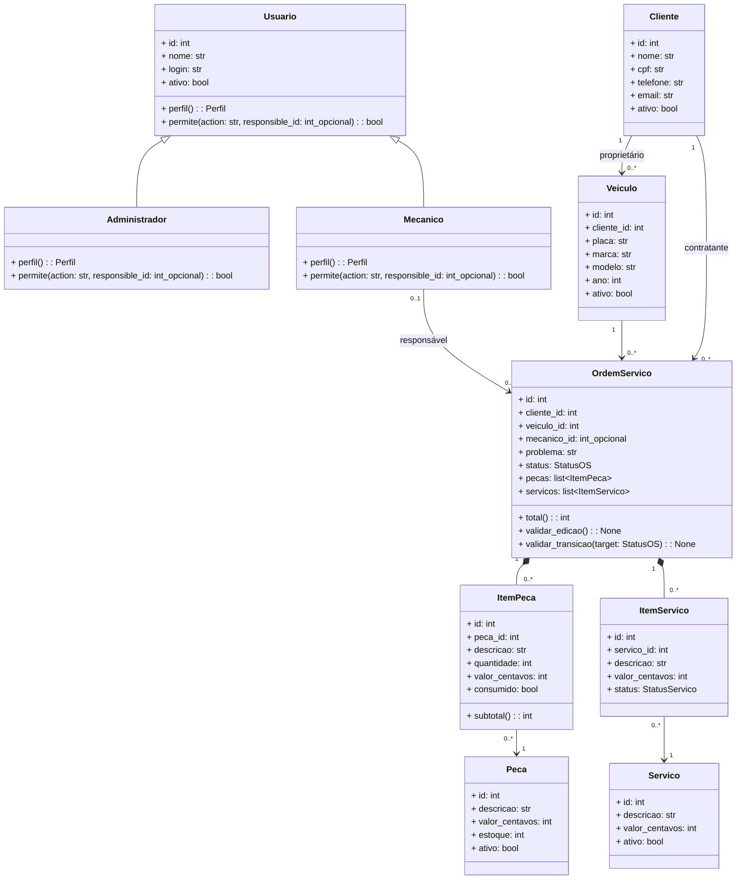

# Diagramas de classes e catálogo de assinaturas

Gerado a partir do código. `+` significa público; `#`, uso interno convencional. `Any` indica ausência de anotação explícita, não uma restrição de execução. Propriedades e métodos gerados pelas dataclasses são explicados no documento principal. Construtores gerados recebem os atributos declarados, incluindo valores padrão quando existentes. Os diagramas abreviam valores padrão; as definições Python são a referência exata.

## Domínio



## Aplicação, persistência, enumerações e exceções

```mermaid
classDiagram
direction TB
class Perfil {
    + ADMIN: 'Administrador'
    + MECANICO: 'Mecânico'
}
class StatusOS {
    + ABERTA: 'Aberta'
    + ORCAMENTO: 'Em orçamento'
    + AGUARDANDO: 'Aguardando aprovação'
    + APROVADA: 'Aprovada'
    + EXECUCAO: 'Em execução'
    + CONCLUIDA: 'Concluída'
    + CANCELADA: 'Cancelada'
}
class StatusServico {
    + PENDENTE: 'Pendente'
    + EXECUCAO: 'Em execução'
    + FINALIZADO: 'Finalizado'
}
class OficinaError {
}
class CampoObrigatorioError {
}
class ValidacaoError {
}
class RegistroNaoEncontradoError {
}
class PersistenciaError {
}
class CarregamentoError {
}
class PermissaoNegadaError {
}
class EstadoInvalidoError {
}
class EstoqueInsuficienteError {
}
class Service {
    + database: Database
    # __init__(database: Any): Any
    + actor(connection: Any, user_id: int, admin: bool): Any
    + active(row: Any, label: str): Any
}
class AuthService {
    + bootstrap(nome: str, login: str, password: str): int
    + has_users(): bool
    + login(login: str, password: str): Any
    + current(actor_id: int): Any
}
class CadastroService {
    + list(actor_id: int, table: str, active_only: bool): list~dict~
    + get(actor_id: int, table: str, record_id: int): Any
    + save(actor_id: int, table: str, data: dict, record_id: int_opcional): int
    # _protect_user(c: Any, user: Any): Any
    + set_active(actor_id: int, table: str, record_id: int, active: bool): Any
    + delete(actor_id: int, table: str, record_id: int): Any
}
class EstoqueService {
    + enter(actor_id: int, part_id: int, quantity: int, reason: str): Any
    + withdraw(actor_id: int, part_id: int, quantity: int, reason: str): Any
    + move(actor_id: int, part_id: int, quantity: int, kind: str, reason: str): Any
    + balances(actor_id: int): list~dict~
    + history(actor_id: int): list~dict~
}
class OrdemService {
    # _access(c: Any, actor_id: Any, order_id: Any, action: Any): Any
    # _audit(c: Any, order_id: Any, actor_id: Any, action: Any, reason: Any): Any
    # _status(c: Any, order: Any, target: Any, actor_id: Any, reason: Any): Any
    # _movement(c: Any, actor_id: Any, order_id: Any, part_id: Any, quantity: Any, kind: Any, reason: Any): Any
    + create(actor_id: int, client_id: int, vehicle_id: int, problem: str, mechanic_id: int_opcional): int
    # _mechanic(repo: Any, mechanic_id: Any): Any
    + edit(actor_id: int, order_id: int, problem: str, mechanic_id: int_opcional): Any
    # _prepare_items(c: Any, actor_id: Any, order_id: Any, reason: Any): Any
    + add_part(actor_id: int, order_id: int, part_id: int, quantity: int, reason: Any): Any
    + add_service(actor_id: int, order_id: int, service_id: int, reason: Any): Any
    + remove_item(actor_id: int, order_id: int, kind: str, item_id: int, reason: Any): Any
    + transition(actor_id: int, order_id: int, target: str, reason: Any): Any
    + item_catalog(actor_id: int, order_id: int): dict
    + approval_pdf(actor_id: int, order_id: int, history: Any): Any
    + update_service(actor_id: int, order_id: int, item_id: int, target: str): Any
    + request_change(actor_id: int, order_id: int, request: str): Any
    + invoice(actor_id: int, order_id: int): Any
    + pay(actor_id: int, order_id: int, amount: int, method: str): Any
    + deliver(actor_id: int, order_id: int): Any
    + list(actor_id: int, search: Any, status: Any, history: Any): list~dict~
    + detail(actor_id: int, order_id: int, history: Any): dict
    # _detail(c: Any, actor_id: Any, order_id: Any, history: Any): Any
    + export_pdf(actor_id: int, order_id: int, history: Any): bytes
}
class Database {
    + path: Path
    # __init__(path: str_ou_Path): Any
    + connect(): sqlite3.Connection
    + transaction(write: bool): Any
    + migrate(): None
}
class Repository {
    + connection: sqlite3.Connection
    # __init__(connection: Any): Any
    + get(table: str, record_id: int): Any
    + user(user_id: int): Any
    + entity(table: str, record_id: int): Any
    + order(order_id: int): OrdemServico
    + available(part_id: int): int
}
OficinaError <|-- CampoObrigatorioError
OficinaError <|-- ValidacaoError
OficinaError <|-- RegistroNaoEncontradoError
OficinaError <|-- PersistenciaError
OficinaError <|-- CarregamentoError
OficinaError <|-- PermissaoNegadaError
OficinaError <|-- EstadoInvalidoError
OficinaError <|-- EstoqueInsuficienteError
Service <|-- AuthService
Service <|-- CadastroService
Service <|-- EstoqueService
Service <|-- OrdemService
Service "0..*" --> "1" Database : utiliza
Repository ..> OrdemServico : reconstitui
Repository ..> Usuario : reconstitui perfil concreto
OrdemService ..> Repository
CadastroService ..> Repository
EstoqueService ..> Repository
AuthService ..> Repository
OrdemServico ..> StatusOS
ItemServico ..> StatusServico
Usuario ..> Perfil
```



## Catálogo legível das assinaturas

### Usuario

Origem: `src/oficina/domain/entities.py`. Bases: ABC.

```text
+ id: int
+ nome: str
+ login: str
+ ativo: bool
+ perfil(): Perfil [property]
+ permite(action: str, responsible_id: int | None): bool
```

### Administrador

Origem: `src/oficina/domain/entities.py`. Bases: Usuario.

```text
+ perfil(): Perfil [property]
+ permite(action: str, responsible_id: int | None): bool
```

### Mecanico

Origem: `src/oficina/domain/entities.py`. Bases: Usuario.

```text
+ perfil(): Perfil [property]
+ permite(action: str, responsible_id: int | None): bool
```

### Cliente

Origem: `src/oficina/domain/entities.py`.

```text
+ id: int
+ nome: str
+ cpf: str
+ telefone: str
+ email: str
+ ativo: bool
```

### Veiculo

Origem: `src/oficina/domain/entities.py`.

```text
+ id: int
+ cliente_id: int
+ placa: str
+ marca: str
+ modelo: str
+ ano: int
+ ativo: bool
```

### Peca

Origem: `src/oficina/domain/entities.py`.

```text
+ id: int
+ descricao: str
+ valor_centavos: int
+ estoque: int
+ ativo: bool
```

### Servico

Origem: `src/oficina/domain/entities.py`.

```text
+ id: int
+ descricao: str
+ valor_centavos: int
+ ativo: bool
```

### ItemPeca

Origem: `src/oficina/domain/entities.py`.

```text
+ id: int
+ peca_id: int
+ descricao: str
+ quantidade: int
+ valor_centavos: int
+ consumido: bool
+ subtotal(): int [property]
```

### ItemServico

Origem: `src/oficina/domain/entities.py`.

```text
+ id: int
+ servico_id: int
+ descricao: str
+ valor_centavos: int
+ status: StatusServico
```

### OrdemServico

Origem: `src/oficina/domain/entities.py`.

```text
+ id: int
+ cliente_id: int
+ veiculo_id: int
+ mecanico_id: int | None
+ problema: str
+ status: StatusOS
+ pecas: list[ItemPeca]
+ servicos: list[ItemServico]
+ total(): int [property]
+ validar_edicao(): None
+ validar_transicao(target: StatusOS): None
```

### Perfil

Origem: `src/oficina/domain/enums.py`. Bases: StrEnum.

```text
+ ADMIN: 'Administrador'
+ MECANICO: 'Mecânico'
```

### StatusOS

Origem: `src/oficina/domain/enums.py`. Bases: StrEnum.

```text
+ ABERTA: 'Aberta'
+ ORCAMENTO: 'Em orçamento'
+ AGUARDANDO: 'Aguardando aprovação'
+ APROVADA: 'Aprovada'
+ EXECUCAO: 'Em execução'
+ CONCLUIDA: 'Concluída'
+ CANCELADA: 'Cancelada'
```

### StatusServico

Origem: `src/oficina/domain/enums.py`. Bases: StrEnum.

```text
+ PENDENTE: 'Pendente'
+ EXECUCAO: 'Em execução'
+ FINALIZADO: 'Finalizado'
```

### OficinaError

Origem: `src/oficina/domain/exceptions.py`. Bases: Exception.

```text
Sem membros próprios adicionais.
```

### CampoObrigatorioError

Origem: `src/oficina/domain/exceptions.py`. Bases: OficinaError.

```text
Sem membros próprios adicionais.
```

### ValidacaoError

Origem: `src/oficina/domain/exceptions.py`. Bases: OficinaError.

```text
Sem membros próprios adicionais.
```

### RegistroNaoEncontradoError

Origem: `src/oficina/domain/exceptions.py`. Bases: OficinaError.

```text
Sem membros próprios adicionais.
```

### PersistenciaError

Origem: `src/oficina/domain/exceptions.py`. Bases: OficinaError.

```text
Sem membros próprios adicionais.
```

### CarregamentoError

Origem: `src/oficina/domain/exceptions.py`. Bases: OficinaError.

```text
Sem membros próprios adicionais.
```

### PermissaoNegadaError

Origem: `src/oficina/domain/exceptions.py`. Bases: OficinaError.

```text
Sem membros próprios adicionais.
```

### EstadoInvalidoError

Origem: `src/oficina/domain/exceptions.py`. Bases: OficinaError.

```text
Sem membros próprios adicionais.
```

### EstoqueInsuficienteError

Origem: `src/oficina/domain/exceptions.py`. Bases: OficinaError.

```text
Sem membros próprios adicionais.
```

### Service

Origem: `src/oficina/application/base.py`.

```text
+ database: Database
# __init__(database: Any): Any
+ actor(connection: Any, user_id: int, admin: bool): Any
+ active(row: Any, label: str): Any
```

### AuthService

Origem: `src/oficina/application/auth_service.py`. Bases: Service.

```text
+ bootstrap(nome: str, login: str, password: str): int
+ has_users(): bool
+ login(login: str, password: str): Any
+ current(actor_id: int): Any
```

### CadastroService

Origem: `src/oficina/application/cadastro_service.py`. Bases: Service.

```text
+ list(actor_id: int, table: str, active_only: bool): list[dict]
+ get(actor_id: int, table: str, record_id: int): Any
+ save(actor_id: int, table: str, data: dict, record_id: int | None): int
# _protect_user(c: Any, user: Any): Any
+ set_active(actor_id: int, table: str, record_id: int, active: bool): Any
+ delete(actor_id: int, table: str, record_id: int): Any
```

### EstoqueService

Origem: `src/oficina/application/estoque_service.py`. Bases: Service.

```text
+ enter(actor_id: int, part_id: int, quantity: int, reason: str): Any
+ withdraw(actor_id: int, part_id: int, quantity: int, reason: str): Any
+ move(actor_id: int, part_id: int, quantity: int, kind: str, reason: str): Any
+ balances(actor_id: int): list[dict]
+ history(actor_id: int): list[dict]
```

### OrdemService

Origem: `src/oficina/application/ordem_service.py`. Bases: Service.

```text
# _access(c: Any, actor_id: Any, order_id: Any, action: Any): Any
# _audit(c: Any, order_id: Any, actor_id: Any, action: Any, reason: Any): Any
# _status(c: Any, order: Any, target: Any, actor_id: Any, reason: Any): Any
# _movement(c: Any, actor_id: Any, order_id: Any, part_id: Any, quantity: Any, kind: Any, reason: Any): Any
+ create(actor_id: int, client_id: int, vehicle_id: int, problem: str, mechanic_id: int | None): int
# _mechanic(repo: Any, mechanic_id: Any): Any
+ edit(actor_id: int, order_id: int, problem: str, mechanic_id: int | None): Any
# _prepare_items(c: Any, actor_id: Any, order_id: Any, reason: Any): Any
+ add_part(actor_id: int, order_id: int, part_id: int, quantity: int, reason: Any): Any
+ add_service(actor_id: int, order_id: int, service_id: int, reason: Any): Any
+ remove_item(actor_id: int, order_id: int, kind: str, item_id: int, reason: Any): Any
+ transition(actor_id: int, order_id: int, target: str, reason: Any): Any
+ item_catalog(actor_id: int, order_id: int): dict
+ approval_pdf(actor_id: int, order_id: int, history: Any): Any
+ update_service(actor_id: int, order_id: int, item_id: int, target: str): Any
+ request_change(actor_id: int, order_id: int, request: str): Any
+ invoice(actor_id: int, order_id: int): Any
+ pay(actor_id: int, order_id: int, amount: int, method: str): Any
+ deliver(actor_id: int, order_id: int): Any
+ list(actor_id: int, search: Any, status: Any, history: Any): list[dict]
+ detail(actor_id: int, order_id: int, history: Any): dict
# _detail(c: Any, actor_id: Any, order_id: Any, history: Any): Any
+ export_pdf(actor_id: int, order_id: int, history: Any): bytes
```

### Database

Origem: `src/oficina/infrastructure/database.py`.

```text
+ path: Path
# __init__(path: str | Path): Any
+ connect(): sqlite3.Connection
+ transaction(write: bool): Any
+ migrate(): None
```

### Repository

Origem: `src/oficina/infrastructure/repositories.py`.

```text
+ connection: sqlite3.Connection
# __init__(connection: Any): Any
+ get(table: str, record_id: int): Any
+ user(user_id: int): Any
+ entity(table: str, record_id: int): Any
+ order(order_id: int): OrdemServico
+ available(part_id: int): int
```

