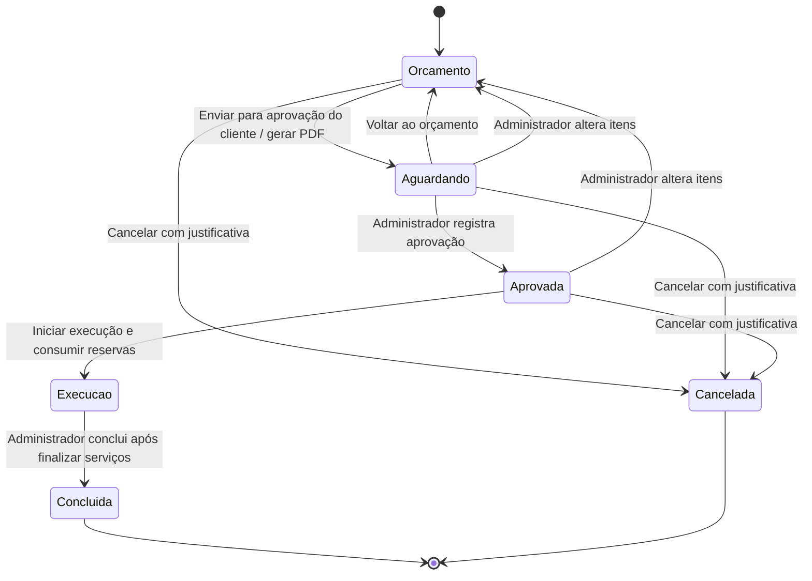

# Oficina Mecânica

## Gestão de Ordem de Serviço Automotiva

**Programação Orientada a Objetos - BRIPROO 2026/2**  
**Autoria informada no documento original:** Ingrid Alves Oliveira de Jesus  
**Prontuário:** BI-3018521  
**Revisão:** 09/11/2026

Documento consolidado das atividades 1, 2, 3 e 4, com a descrição da implementação atual. O enunciado da disciplina orienta a organização; o código é a referência para nomes de classes, responsabilidades e comportamento implementado. Não se presume um segundo integrante nem uma publicação remota que não constem do material recebido.

## Atividade 1 - Definição do sistema

### 1.1 Identificação, problema e solução

**Nome:** Oficina Mecânica - Gestão de Ordem de Serviço Automotiva. **Área:** manutenção e reparação de veículos. A identidade visual em tons de rosa e a logo representam uma oficina voltada ao público feminino; o uso do sistema não depende do gênero do cliente.

Registros em papel e planilhas isoladas dificultam consultar o histórico de um veículo, conhecer o andamento dos reparos e controlar peças, serviços e valores. A duplicação de informações também pode causar divergências entre o orçamento, o estoque e o atendimento efetivamente realizado.

A solução centraliza clientes, veículos, funcionários, peças, serviços e ordens de serviço em uma aplicação web com Python, Streamlit e SQLite. O navegador apresenta a interface; o servidor Python e o banco são executados localmente. Portanto, a versão entregue exige instalação no computador que hospeda a aplicação e não equivale a um serviço já publicado na internet.

### 1.2 Público, objetivo e funcionalidades

Os usuários diretos são administradores e mecânicos. Clientes são pessoas físicas cadastradas, beneficiárias do atendimento e destinatárias do orçamento; não possuem login ou portal próprio. O papel de atendente é desempenhado por um usuário administrador, não por um terceiro perfil.

O objetivo geral é organizar o atendimento desde o orçamento até a entrega, preservando o histórico e controlando permissões, estoque e valores. As funcionalidades principais são autenticação; manutenção dos cadastros; entrada e saída de estoque; abertura, edição, orçamento e acompanhamento da OS; execução dos serviços; faturamento, pagamento e entrega; pesquisa histórica; emissão de PDF; e registro das mudanças de situação.

### 1.3 Processo principal e justificativa

O administrador identifica o cliente e o veículo e abre uma OS em orçamento. Administrador ou mecânico responsável inclui os itens conforme suas permissões. O administrador envia o orçamento para aprovação do cliente: o sistema muda a situação, gera e armazena o PDF e inicia seu download. A resposta do cliente é registrada pelo administrador. Após a aprovação, a execução consome as peças reservadas; os serviços são iniciados e finalizados. O administrador conclui a OS, fatura, registra o recebimento integral e a entrega.

O tema permite modelar objetos com responsabilidades distintas e relações de associação, composição e herança. O processo vai além de cadastros isolados: uma decisão de aprovação afeta a execução, o consumo de estoque e a possibilidade de faturamento. A continuidade do tema anteriormente explorado em Programação Orientada a Eventos também permite comparar eventos de interface com regras e responsabilidades orientadas a objetos.

## Atividade 2 - Requisitos e regras de negócio

### 2.1 Requisitos funcionais

| Código | Comportamento especificado e correspondência no sistema |
|---|---|
| RF01 | Cadastrar, consultar e editar clientes com nome, CPF e contatos; inativar ou excluir quando permitido. |
| RF02 | Cadastrar e editar veículos vinculados a clientes; escolher o ano em uma lista. |
| RF03 | Cadastrar funcionários com perfil Administrador ou Mecânico, editar dados e controlar sua atividade. |
| RF04 | Criar o primeiro administrador, autenticar usuários e encerrar a sessão. |
| RF05 | Manter o catálogo de peças com descrição, preço e consulta do saldo de estoque. |
| RF06 | Manter o catálogo de serviços e seus preços. |
| RF07 | Abrir uma OS com cliente, veículo e problema relatado, inicialmente Em orçamento. |
| RF08 | Adicionar peças e serviços e remover itens conforme perfil, situação e início do consumo ou execução. |
| RF09 | Controlar as transições de orçamento, aprovação, execução, conclusão e cancelamento. |
| RF10 | Pesquisar ordens e histórico por cliente, CPF ou placa, respeitando o escopo do usuário. |
| RF11 | Calcular o total pela soma dos subtotais das peças e dos valores dos serviços. |
| RF12 | Registrar entradas e saídas manuais de estoque, com quantidade, responsável, data e justificativa opcional. |
| RF13 | Iniciar e finalizar cada serviço de uma OS em execução. |
| RF14 | Registrar faturamento, pagamento integral e entrega na aba Faturamento da OS, exclusiva do administrador. |
| RF15 | Gerar e persistir uma versão do PDF no envio para aprovação e iniciar o download sem exigir um segundo botão. |
| RF16 | Exportar a situação atual da OS em PDF pelo botão de download já existente, com a logo e dados do atendimento. |
| RF17 | Consultar histórico de situações e auditoria; registrar solicitações do mecânico para análise administrativa. |
| RF18 | Exibir erros compreensíveis e confirmações temporárias, inclusive na criação do primeiro usuário. |
| RF19 | Enviar formulários somente pela ativação de seu botão de ação; pressionar Enter em um campo não submete o formulário. |

RF14 tem uma divergência de nomenclatura nas formas de cartão na versão inspecionada; a seção 5.6 registra a limitação sem apresentá-la como funcionalidade validada.

### 2.2 Requisitos não funcionais

| Código | Requisito e decisão de implementação |
|---|---|
| RNF01 | Interface web organizada em páginas e abas, com tema rosa, logo e componentes de formulário do Streamlit. A adequação a todos os tamanhos de tela não é presumida como validada. |
| RNF02 | Separação entre apresentação, casos de uso, domínio e infraestrutura, com classes e responsabilidades explícitas. |
| RNF03 | Mensagens de falha sem exposição direta de caminhos internos, SQL ou rastreamento técnico ao usuário. |
| RNF04 | Persistência relacional em SQLite, com chaves estrangeiras, restrições e migrações versionadas. |
| RNF05 | Autenticação com hash de senha PBKDF2-HMAC-SHA256 e salt individual; permissões reavaliadas no servidor a cada operação. |
| RNF06 | Operações relacionadas devem ser atômicas: itens, movimentos, auditoria, transição e PDF confirmado não podem ficar parcialmente gravados. |
| RNF07 | Valores monetários em centavos inteiros; datas persistidas em UTC e apresentadas em America/Sao_Paulo. |
| RNF08 | Código verificável com testes isolados de domínio, persistência e interface, sem usar o banco operacional como base de testes. |

### 2.3 Perfis e permissões

| Operação | Administrador | Mecânico |
|---|---|---|
| Cadastros e estoque | Permitido, sujeito às regras | Não permitido |
| Abrir ou editar dados gerais de OS | Permitido | Não permitido |
| Consultar OS | Todas | Somente as atribuídas a ele |
| Consultar histórico | Todos os veículos | Veículos que tenham OS atribuída a ele; consulta não concede edição |
| Adicionar peças e serviços | Conforme o estado da OS | Somente em suas OS Em orçamento, inclusive após retorno à revisão |
| Remover itens | Conforme consumo e execução | Não permitido; pode solicitar alteração |
| Enviar, aprovar ou voltar ao orçamento | Permitido | Não permitido |
| Iniciar execução da OS | Permitido | Permitido em sua OS aprovada |
| Iniciar e finalizar serviços | Permitido | Permitido em sua OS em execução |
| Concluir ou cancelar OS | Permitido, conforme o estado | Não permitido |
| Faturar, receber e entregar | Permitido | Não permitido; a aba Faturamento fica oculta |
| Exportar PDF | No seu escopo de consulta | No seu escopo, sem dados de faturamento ou pagamento |

### 2.4 Regras de negócio

- **RN01:** somente o administrador conclui uma OS; ela deve estar Em execução, conter ao menos um serviço e ter todos os serviços Finalizados.
- **RN02:** OS Concluída ou Cancelada não recebe novos itens nem alterações de andamento.
- **RN03:** cliente com histórico não pode ser excluído; usa-se inativação quando não houver OS em andamento. Outros cadastros vinculados também são protegidos por restrições referenciais.
- **RN04:** veículo exige cliente existente; novas OS exigem cliente e veículo ativos, e o veículo deve pertencer ao cliente selecionado.
- **RN05:** peça somente pode ser incluída se estiver ativa e a quantidade solicitada couber no estoque disponível.
- **RN06:** iniciar a execução exige mecânico responsável ativo e OS previamente Aprovada.
- **RN07:** envio para aprovação, aprovação, retorno ao orçamento, faturamento, pagamento e entrega são operações administrativas.
- **RN08:** nome, CPF, placa, marca, modelo, ano, descrição, preços, quantidades e demais obrigatórios são validados conforme o cadastro. CPF, placa e login são únicos.
- **RN09:** novas senhas e alterações exigem no mínimo oito caracteres, uma letra maiúscula, uma minúscula e um caractere especial que não seja espaço. A tela não anuncia o limite máximo. Senhas existentes são verificadas pelo hash, sem imposição retroativa da nova composição.
- **RN10:** uma OS nasce Em orçamento. O estado Aberta permanece apenas para compatibilidade com registros antigos; a migração converte esses registros para o fluxo atual.
- **RN11:** envio e aprovação exigem ao menos um serviço. É permitido preparar inicialmente um orçamento sem itens, mas não enviá-lo nesse estado.
- **RN12:** enquanto aguarda aprovação, a OS pode voltar ao orçamento. O retorno preserva itens, reservas e histórico. O mecânico responsável volta a poder adicionar itens.
- **RN13:** alteração administrativa de itens em orçamento pendente ou aprovado invalida a aprovação e retorna a OS a Em orçamento. Uma operação rejeitada não deve produzir esse retorno parcialmente.
- **RN14:** alterações de itens durante a execução exigem administrador e justificativa. Peças adicionadas nessa etapa são consumidas imediatamente.
- **RN15:** peça já consumida e serviço já iniciado não podem ser removidos. Cancelamento ocorre somente antes da execução, com justificativa e liberação das reservas.
- **RN16:** o estoque disponível corresponde ao saldo físico menos as reservas ainda não consumidas de OS não canceladas. Saídas manuais não podem retirar esse saldo reservado.
- **RN17:** o serviço segue Pendente → Em execução → Finalizado, sem pular a etapa intermediária; a OS precisa estar Em execução.
- **RN18:** faturamento exige OS concluída e é único por OS. Pagamento integral é único por fatura; Sem cobrança é usado somente para valor zero. Entrega exige conclusão e pagamento registrado.
- **RN19:** descrição e valor de cada item são copiados do catálogo na inclusão. Mudar o preço do catálogo não recalcula os itens antigos.
- **RN20:** o último administrador ativo é protegido; um mecânico com OS em andamento precisa ter as ordens reatribuídas ou finalizadas antes de sua inativação ou mudança de perfil.
- **RN21:** transferência do veículo para outro cliente exige ausência de OS em andamento; o atendimento antigo mantém seu cliente contratante original.
- **RN22:** cada envio para aprovação gera uma versão do PDF, salva no SQLite na mesma transação da mudança de estado. Se a geração ou gravação falhar, o envio não é confirmado. O download ocorre somente após a confirmação da transação.

### 2.5 Processo detalhado e estados

1. O administrador cadastra cliente e veículo, funcionários, catálogo de serviços e peças; repõe o estoque quando necessário.
2. Abre a OS Em orçamento, com o problema relatado e, opcionalmente, um mecânico responsável.
3. Inclui serviços e peças. O mecânico atribuído também pode incluir itens nessa etapa. Peças ficam reservadas e o total é recalculado.
4. Aciona **Enviar para aprovação do cliente**. O sistema valida, muda para Aguardando aprovação, gera o PDF com a logo e persiste sua versão. Após confirmar a gravação, inicia o download no navegador. Não aparece um novo botão para gerar esse arquivo.
5. O usuário compartilha o documento com o cliente pelos meios da oficina. O sistema não envia e-mail ou mensagem e não possui aprovação digital pelo cliente.
6. Diante de recusa ou pedido de alteração, o administrador usa **Voltar ao orçamento** e revisa os itens. Um reenvio produz nova versão, sem apagar a anterior.
7. Com a concordância do cliente, o administrador registra **Aprovar orçamento**. Administrador ou mecânico responsável inicia a execução; reservas se tornam consumo de estoque.
8. Os serviços são iniciados e finalizados individualmente. Pedidos de alteração podem ser registrados no histórico.
9. O administrador conclui a OS, registra faturamento, recebimento integral e entrega. Esses três últimos eventos são registros próprios, não novos estados da OS.
10. Os atendimentos permanecem disponíveis para pesquisa e exportação no escopo autorizado.

## Atividade 3 - Identificação das classes

### 3.1 Organização e convenções

As entidades de domínio estão em `src/oficina/domain/entities.py`. `Usuario`, `Administrador`, `Mecanico`, `Cliente`, `Veiculo`, `Peca`, `Servico`, `ItemPeca` e `ItemServico` são dataclasses imutáveis (`frozen=True`); `OrdemServico` é mutável e contém listas de itens. Tipos `int | None` representam vínculos opcionais. Valores monetários usam centavos, não `float`.

O documento original previa métodos como `Cliente.cadastrar()` e `Peca.atualizarEstoque()`. Eles não existem nessas entidades na implementação atual. Cadastro, validação de entrada e persistência são coordenados pelos serviços abaixo. `__init__`, `__repr__` e `__eq__` são gerados pelas dataclasses, não métodos de cadastro escritos manualmente.

### 3.2 Entidades de domínio

| Classe | Finalidade e responsabilidade | Atributos próprios | Métodos e propriedades próprios |
|---|---|---|---|
| Usuario | Abstração de funcionário autenticado; contrato de perfil e autorização. | id: int; nome: str; login: str; ativo: bool | perfil: Perfil (abstrata); permite(action: str, responsible_id: int ou None = None): bool (abstrato) |
| Administrador | Especialização administrativa; autoriza ações de usuário ativo, sujeitas às regras dos serviços. | Herda Usuario. | perfil: Perfil; permite(action: str, responsible_id: int ou None = None): bool |
| Mecanico | Especialização técnica; autoriza consulta, execução e inclusão no escopo atribuído. | Herda Usuario. | perfil: Perfil; permite(action: str, responsible_id: int ou None = None): bool |
| Cliente | Representa pessoa física contratante e seus contatos. | id: int; nome: str; cpf: str; telefone: str; email: str; ativo: bool | Sem métodos de negócio próprios; manutenção por CadastroService. |
| Veiculo | Identifica automóvel e seu proprietário atual. | id: int; cliente_id: int; placa: str; marca: str; modelo: str; ano: int; ativo: bool | Sem métodos de negócio próprios; manutenção por CadastroService. |
| Peca | Representa item de catálogo, preço e saldo físico. | id: int; descricao: str; valor_centavos: int; estoque: int; ativo: bool | Sem métodos de negócio próprios; manutenção por CadastroService e EstoqueService. |
| Servico | Representa tipo de mão de obra e preço de catálogo. | id: int; descricao: str; valor_centavos: int; ativo: bool | Sem métodos de negócio próprios; manutenção por CadastroService. |
| ItemPeca | Registra a participação de uma peça na OS, preservando preço, descrição e quantidade. | id: int; peca_id: int; descricao: str; quantidade: int; valor_centavos: int; consumido: bool | subtotal: int, propriedade calculada por quantidade × valor_centavos. |
| ItemServico | Registra a participação de um serviço na OS e seu andamento independente. | id: int; servico_id: int; descricao: str; valor_centavos: int; status: StatusServico | Sem métodos de negócio próprios; andamento por OrdemService.update_service. |
| OrdemServico | Agregado central do atendimento; reúne itens, calcula total e valida estado e transições. | id: int; cliente_id: int; veiculo_id: int; mecanico_id: int ou None; problema: str; status: StatusOS; pecas: list[ItemPeca]; servicos: list[ItemServico] | total: int; validar_edicao(): None; validar_transicao(target: StatusOS): None |

Datas de abertura, conclusão e entrega são campos persistidos e expostos no dicionário `metadata`, não atributos declarados em `OrdemServico`. O hash da senha fica na tabela `usuarios`, não no objeto `Usuario` devolvido à interface. O cliente é uma entidade distinta de usuário autenticado.

### 3.3 Serviços de aplicação

| Classe | Responsabilidade e estado | Operações principais |
|---|---|---|
| Service | Base compartilhada, com database: Database. Recarrega usuário e atividade em cada operação. | actor(connection, user_id: int, admin: bool = False): Usuario; active(row, label: str): None |
| AuthService | Autentica e cria somente o administrador inicial; herda Service. | bootstrap(nome: str, login: str, password: str): int; has_users(): bool; login(login: str, password: str): Usuario; current(actor_id: int): Usuario |
| CadastroService | Coordena validação, consulta, criação, edição e situação dos cinco cadastros; herda Service. | list(actor_id: int, table: str, active_only: bool = False): list[dict]; get(actor_id: int, table: str, record_id: int): entidade; save(actor_id: int, table: str, data: dict, record_id: int ou None = None): int; set_active(actor_id: int, table: str, record_id: int, active: bool): None; delete(actor_id: int, table: str, record_id: int): None |
| EstoqueService | Coordena entrada, saída, saldo disponível e movimentos; herda Service. | enter(actor_id: int, part_id: int, quantity: int, reason: str = ''): None; withdraw com os mesmos parâmetros; move(actor_id: int, part_id: int, quantity: int, kind: str, reason: str = ''): None; balances(actor_id: int): list[dict]; history(actor_id: int): list[dict] |
| OrdemService | Executa o ciclo da OS, autorização, itens, PDF, histórico e eventos financeiros; herda Service. | create, edit, add_part, add_service, remove_item, transition, item_catalog, approval_pdf, update_service, request_change, invoice, pay, deliver, list, detail e export_pdf. Assinaturas completas no catálogo UML anexo. |

Os retornos descritos como Usuario, entidade, None ou dict nos casos sem anotação explícita são tipos inferidos do comportamento do código. Não representam declarações adicionais no arquivo Python. Métodos internos prefixados por `_`, como `_access`, `_prepare_items`, `_status`, `_movement`, `_audit` e `_detail`, organizam a implementação; o prefixo indica uso interno por convenção Python, não privacidade imposta pela linguagem.

### 3.4 Infraestrutura, enumerações e exceções

**Database** possui `path: Path`; `connect(): sqlite3.Connection`, `transaction(write: bool = False)` (gerenciador de contexto) e `migrate(): None`. Abre conexões, ativa chaves estrangeiras, confirma ou reverte operações e aplica migrações.

**Repository** possui `connection: sqlite3.Connection`; `get(table: str, record_id: int): sqlite3.Row`, `user(user_id: int): Usuario`, `entity(table: str, record_id: int): entidade`, `order(order_id: int): OrdemServico` e `available(part_id: int): int`. Reconstrói objetos a partir das tabelas e calcula disponibilidade.

**Perfil**, **StatusOS** e **StatusServico** são enumerações de valores permitidos. **OficinaError** é a base das exceções de negócio; especializações: **CampoObrigatorioError**, **ValidacaoError**, **RegistroNaoEncontradoError**, **PersistenciaError**, **CarregamentoError**, **PermissaoNegadaError**, **EstadoInvalidoError** e **EstoqueInsuficienteError**. Essas subclasses não adicionam atributos ou métodos próprios, mas permitem distinguir as causas das falhas.

As telas são funções nos módulos `ui/main.py`, `ui/catalogs.py` e `ui/orders.py`. Validação, segurança, formatação e geração de PDF também incluem funções de módulo. A documentação não transforma artificialmente cada função em uma classe.

## Atividade 4 - Modelagem e relacionamentos

### 4.1 Diagrama atualizado

O anexo **DIAGRAMA_CLASSES.md** contém o diagrama de domínio e o diagrama de suporte, com atributos, operações, parâmetros, tipos, visibilidade e multiplicidades. O PDF traz vistas gráficas equivalentes. `+` indica público; `#` indica uso interno convencional, sem controle de acesso automático em Python. Propriedades calculadas são identificadas como propriedades, não colunas de banco.

### 4.2 Justificativa dos relacionamentos

| Relação | Multiplicidade e justificativa |
|---|---|
| Usuario / Administrador / Mecanico | Generalização e especialização. As subclasses concretizam o contrato abstrato de perfil e permissão. |
| Service / serviços concretos | Generalização técnica para compartilhar acesso ao banco e verificação do usuário. |
| Cliente - Veiculo | Cliente 1 para Veiculo 0..*. Um cliente pode existir antes de ter veículo; cada veículo possui exatamente um proprietário atual. |
| Cliente - OrdemServico | Cliente 1 para OS 0..*. Cada OS preserva um contratante, mesmo após transferência do veículo. |
| Veiculo - OrdemServico | Veículo 1 para OS 0..*. Cada OS refere-se a exatamente um veículo. |
| Mecanico - OrdemServico | Mecânico 0..1 por OS; cada mecânico pode ter 0..* OS. A associação é opcional no orçamento e obrigatória para iniciar a execução. |
| OrdemServico - ItemPeca | Composição 1 para 0..*. Cada item pertence a uma única OS e não possui uso independente. A composição conceitual não significa que exista exclusão física de OS ou cascata SQL. |
| OrdemServico - ItemServico | Composição 1 para 0..*. Durante a preparação, a OS pode não ter serviços; o mínimo de um é exigido na transição para aprovação e conclusão. |
| ItemPeca - Peca | Cada item referencia uma peça; uma peça pode aparecer em 0..* itens. O catálogo existe independentemente das OS. |
| ItemServico - Servico | Cada item referencia um serviço; um serviço pode aparecer em 0..* itens. O andamento pertence ao item, não ao catálogo. |
| Service - Database | Associação compartilhada: serviços usam o mesmo objeto de acesso ao banco; não são seus proprietários exclusivos. |
| Repository - entidades | Dependência de criação/reconstituição; Repository instancia objetos concretos a partir de registros. |

Não se usa um losango de agregação diretamente entre OS e Servico: no código, a OS contém ItemServico, que referencia o catálogo. Essa composição com associação ao catálogo representa a independência dos serviços de forma mais fiel do que o desenho original.

### 4.3 Conceitos de orientação a objetos

**Abstração:** entidades representam cliente, veículo, atendimento, catálogo e itens sem depender da interface. `Usuario` é abstrato e exige o contrato `permite`.

**Encapsulamento:** regras de transição e totais estão em OrdemServico; os casos de uso coordenam autorização e persistência. As dataclasses congeladas protegem seus atributos contra atribuição normal. Os atributos não são declarados privados no código; essa limitação não deve ser confundida com ausência de separação de responsabilidades.

**Herança e polimorfismo:** Repository.user escolhe Administrador ou Mecanico. OrdemService chama `actor.permite(...)` através da mesma interface; cada subclasse fornece uma resposta diferente. Service também é a base dos serviços especializados.

**Composição:** OrdemServico contém listas de ItemPeca e ItemServico, com identidade e dados próprios de cada inclusão.

**Sobrescrita e sobrecarga:** Administrador.permite e Mecanico.permite sobrescrevem o método abstrato; isso é sobrescrita, não sobrecarga por assinatura. Python não escolhe entre várias definições homônimas por tipos de parâmetros. O código usa parâmetros opcionais, como `record_id=None` em CadastroService.save, para reunir criação e edição em uma única operação. As dataclasses geram `__eq__`, personalizando a igualdade `==` entre instâncias do mesmo tipo; essa é uma forma de sobrecarga de operador gerada pela biblioteca, não uma implementação manual de sobrecarga de métodos. Caso a avaliação exija esta última especificamente, ela não está implementada e deve ser alinhada com o docente, sem inventar um exemplo no relatório.

## 5. Implementação web, persistência e exceções

### 5.1 Arquitetura e telas

A interface chama serviços de aplicação, que utilizam o domínio e os repositórios dentro de transações SQLite. O domínio não importa Streamlit ou SQLite. A organização física e os comandos para executar o repositório estão no README, evitando duplicar o guia de instalação neste documento.

| Tela ou área | Conteúdo e ações principais |
|---|---|
| Primeiro acesso e login | Criação do administrador inicial, confirmação da senha, autenticação e mensagens de validação. |
| Início | Indicadores de atendimentos e listagem recente no escopo do perfil. |
| Clientes, Veículos, Usuários, Serviços | Cadastro, pesquisa, edição e controle de situação. CPF e telefone têm máscara; ano é uma lista. |
| Peças e estoque | Catálogo, saldos em ordem crescente de ID, entradas, saídas e histórico de movimentos. |
| Ordens de serviço | Abertura, filtros, seleção persistente da OS e PDF da situação atual. |
| Aba Peças e serviços | Itens já adicionados agrupados e formulários de inclusão; remoção administrativa conforme as regras. |
| Aba Andamento | Dados gerais, envio e aprovação, retorno ao orçamento, execução e atualização de serviços. |
| Aba Faturamento | Fatura sem prefixo numérico, pagamento e entrega; somente para administrador. Não há página financeira separada no menu. |
| Histórico e solicitações | Auditoria da OS, transições e solicitações do mecânico. A página Histórico permite consulta de atendimentos anteriores. |

O menu administrativo segue Início, Clientes, Veículos, Usuários, Serviços, Peças e estoque, Ordens de serviço e Histórico. O mecânico acessa Início, Ordens de serviço e Histórico. Formulários usam `enter_to_submit=False`: Enter nos campos não confirma o envio. Pesquisas e seleção de filtros são interações de consulta, sem gravação de cadastro. Botões mantêm ativação normal por teclado quando recebem foco, preservando acessibilidade.

Confirmações são temporárias e desaparecem após interação ou tempo de exibição. Erros permanecem legíveis para permitir correção. A OS e sua aba selecionada são preservadas nas atualizações, inclusive se uma mudança de estado a retirar do filtro atual.

### 5.2 Armazenamento e recuperação dos objetos

| Tabelas | Conteúdo e vínculos |
|---|---|
| usuarios | Identificação, login único, hash da senha, perfil e atividade. |
| clientes / veiculos | Contratantes e veículos; veiculos.cliente_id referencia clientes. |
| pecas / servicos | Catálogos; peças incluem saldo físico. |
| ordens_servico | Cliente, veículo, mecânico opcional, problema, situação e datas. |
| itens_peca_os / itens_servico_os | Composição persistida da OS; preço e descrição históricos, quantidades e andamento. |
| movimentacoes_estoque | Entrada, Saída, Reserva, Liberação, Consumo ou Devolução; peça, usuário, quantidade, data e OS quando aplicável. Devolução é tipo previsto no banco, sem ação de devolução disponível na interface atual. |
| historico_status_os / auditoria_os | Situações anteriores e novas, responsáveis, justificativas e ações. |
| faturamentos / pagamentos | Uma fatura por OS e um pagamento por fatura, com restrições de unicidade. |
| orcamentos_pdf | OS, versão, bytes do PDF, usuário e data. Cada reenvio preserva as versões existentes. |
| schema_migrations | Identificação das migrações aplicadas. |

Database.migrate aplica os arquivos SQL em ordem e registra cada versão. Escritas usam `BEGIN IMMEDIATE` para serializar disputas por saldo. Os parâmetros de dados são separados do SQL; nomes dinâmicos de tabelas são restritos a conjuntos internos. Chaves estrangeiras e restrições complementam as regras Python.

Repository.order carrega a OS e seus itens e reconstrói OrdemServico, ItemPeca e ItemServico. Repository.user instancia a subclasse correspondente ao perfil. Assim, os objetos são recuperados a partir do banco relacional; não são gravados por pickle ou serialização de objetos executáveis.

### 5.3 PDF no envio para aprovação

OrdemService.transition gera o PDF a partir dos dados da própria transação, grava sua versão e confirma a alteração. Seu retorno entrega os bytes e a versão à interface somente se a confirmação do banco ocorrer. A interface agenda a transferência e o componente local inicia um download de arquivo PDF, sem criar um novo botão. Um identificador por evento evita repetir o download em uma remontagem do componente; a fila é consumida ao renderizar.

O botão preexistente **Baixar ordem de serviço em PDF** continua exportando o estado atual. Ele é independente da versão histórica produzida no envio. A geração do arquivo não significa que o cliente recebeu ou aprovou o orçamento. Configurações do navegador ainda controlam destino e permissões de downloads.

### 5.4 Tratamento de exceções

| Situação exigida | Exceção e exemplo de tratamento |
|---|---|
| Obrigatório ausente | CampoObrigatorioError: nome ou problema vazio; a tela informa o campo necessário. |
| Informação inválida | ValidacaoError: CPF, placa, ano, preço, quantidade ou senha incompatíveis; duplicidade também recebe mensagem compreensível. |
| Registro não encontrado | RegistroNaoEncontradoError: consulta por identificador inexistente ou item ausente da OS. |
| Falha ao salvar | PersistenciaError: erro SQLite em escrita ou falha de geração do PDF de aprovação; o envio não fica parcialmente registrado. |
| Falha ao carregar | CarregamentoError: falha de leitura no banco; não expõe detalhes da conexão. |
| Operação não permitida | PermissaoNegadaError: mecânico tenta faturar, concluir OS ou acessar atendimento fora de seu escopo. |
| Estado incorreto | EstadoInvalidoError: iniciar serviço antes da execução, concluir com pendências ou repetir faturamento. |
| Saldo insuficiente | EstoqueInsuficienteError: reserva ou saída maior que o disponível. |

As exceções previstas herdam de OficinaError. A interface apresenta sua mensagem; falhas inesperadas recebem mensagem genérica e registro técnico em log. Database diferencia falhas de leitura e escrita, reverte erros SQL e fecha conexões. Uma exceção de domínio também impede o commit da transação, e seu fechamento descarta as mudanças pendentes.

### 5.5 Rastreabilidade para a apresentação

| Exigência do enunciado | Evidência no projeto |
|---|---|
| Processo principal além de cadastros | Ciclo de OS e métodos de OrdemService. |
| Classes, objetos e relacionamentos | domain/entities.py, Repository e diagramas anexos. |
| Herança e polimorfismo | Usuario/Administrador/Mecanico e chamadas a permite. |
| Sobrecarga e distinção de conceitos | Seção 4.3; igualdade gerada por dataclass, com limitação explicitada. |
| Páginas, formulários, navegação e eventos | ui/main.py, ui/catalogs.py, ui/orders.py e componentes locais. |
| Validação e regras de negócio | domain/validators.py, OrdemServico e serviços de aplicação. |
| Persistência e recuperação | migrations, Database e Repository. |
| Tratamento dos sete casos de exceção | domain/exceptions.py e seção 5.4. |
| PDF e estados atualizados | order_pdf.py, orcamentos_pdf e ui/downloads.py. |
| Demonstração das telas | Roteiro abaixo, executado em base isolada quando houver validação. |

Roteiro sugerido: apresentar login e perfis; cadastrar cliente e veículo; lançar estoque; abrir OS em orçamento; adicionar itens; enviar e baixar o PDF no mesmo clique; retornar e revisar; aprovar e executar; finalizar serviços como mecânico; concluir como administrador; apresentar faturamento e histórico. Não se afirma que o roteiro inteiro foi reexecutado nesta revisão: por solicitação, a validação desta mudança fica restrita aos formulários e ao download de aprovação. Os cenários antigos permanecem na suíte do repositório.

### 5.6 Limites e pendências da versão descrita

- A aplicação é local, com dois perfis internos e clientes pessoa física. Não há CNPJ, portal do cliente, aprovação eletrônica, envio automático de mensagens, emissão fiscal, parcelamento ou integração bancária.
- Não há exclusão física de OS pela interface, cancelamento em execução, reabertura de OS concluída ou devolução de peça consumida. O histórico é preservado.
- O telefone recebe máscara de entrada, mas o serviço de cadastro não implementa validação estrutural de telefone equivalente à validação de CPF. Não se deve afirmar o contrário.
- O código inspecionado oferece Cartão de Crédito e Cartão de Débito na interface e no serviço de pagamento, mas a migração 002 permite Cartão e Débito na restrição SQL. Até harmonizar esses nomes, o pagamento com as novas opções de cartão pode ser recusado pelo banco. Essa divergência preexistente não foi corrigida nem testada nesta revisão de formulários, download e documentação.
- Não há sobrecarga manual de métodos por assinatura; a descrição correta está na seção 4.3. Metas de desempenho, compatibilidade móvel completa e implantação pública não foram comprovadas.

### 5.7 Referências do projeto

1. Enunciado fornecido: **Projeto Semestral - Sistema Web Orientado a Objetos**, arquivo `c50b0ff6de90-82eaac25fb684550962f7d9f4a1dac24.pdf`, atividades e requisitos de implementação.
2. Documento original fornecido: **BRIPROO_2026-2 Atividade1_2_3_4.pdf**, identificação, tema, requisitos e modelagem inicial.
3. Código do repositório **oficina**, módulos e migrações citados neste documento, revisão de 09/11/2026.
